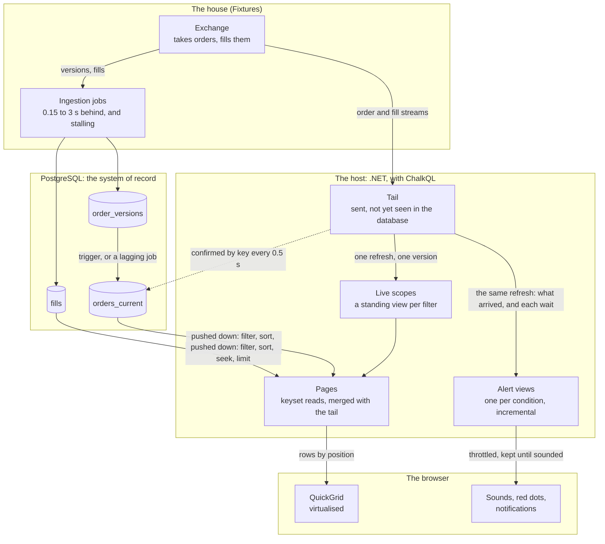
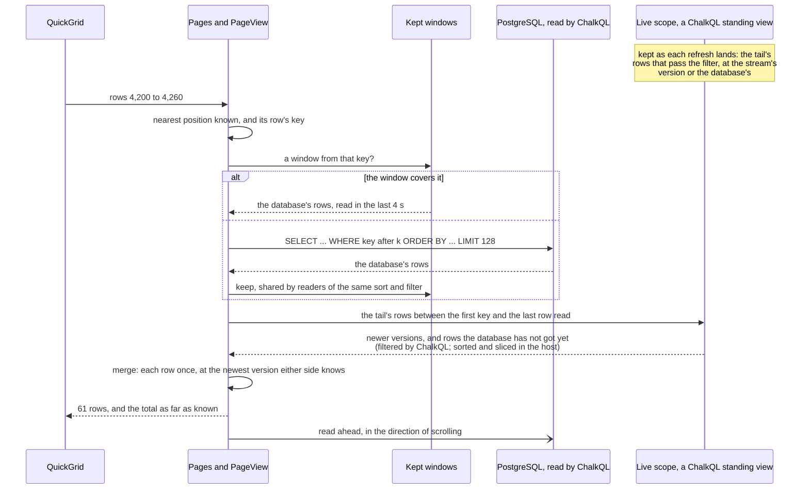

# Virtual blotter: an unobtrusive live grid

A trade blotter in Blazor Server and QuickGrid over five million client orders and their fills in
PostgreSQL, while the house keeps accepting and filling orders. Every tab scrolls through all its rows,
sorts by any columns, filters on any column, flashes what changed and drives alerts. The host holds no
copy of the corpus: it keeps an ephemeral memory cache within a budget of a few megabytes (see
[What ChalkQL brings to the table](#what-chalkql-brings-to-the-table)), with each statement stopped after
5 s, and never shows an order at an older version than one it knows of.

## A bolt-on compromise

Most live views are layered onto existing systems: someone else's database and someone else's feed.
So the blotter is deliberately **bolt-on**, imposing as few prerequisites as it can. Of the database it
asks only rows found by key, sorted and filtered at source, and an estimate of a query's size; of the
streams, only that they are reliable and deliver what is sent after a reader subscribes. ChalkQL makes
the most of that, as [What ChalkQL brings to the table](#what-chalkql-brings-to-the-table) describes.

```bash
dotnet run -c Release --project dotnet/samples/Chalk.Sample.Blotter
```

Then open `http://localhost:5910`. You need a JDK 21+ for ChalkQL's planner and PostgreSQL 16 or later;
see [Getting a working tree](../../../CONTRIBUTING.md#getting-a-working-tree) to install both. The
sample starts its own PostgreSQL server in a temporary directory and deletes it on stopping; the next
run sweeps away any left by a killed one.

| Option                                      | Default                                                       |                                                                                                                                                           |
|---------------------------------------------|---------------------------------------------------------------|-----------------------------------------------------------------------------------------------------------------------------------------------------------|
| `--orders 500k`                             | `5m`                                                          | corpus size: orders, with their versions and fills                                                                                                        |
| `--current lagging`                         | `trigger`                                                     | how `orders_current` keeps up with `order_versions` (below)                                                                                               |
| `--disorder 0.02`                           | off                                                           | start out of order: send that share of each stream's rows late, and write half as many to the database before sending them (below); toggle it on the page |
| `--postgres "Host=…;Username=…;Database=…"` |                                                               | use your own server: the sample creates schema `blotter`, refuses if it exists, and drops it on stopping                                                  |
| `--pg-bin /path/to/postgresql/bin`          | found                                                         | the installation to start a server from                                                                                                                   |
| `--budget-mb 32`                            | found                                                         | fix the memory budget; without it, the host finds one (below); change it on the page while running                                                        |
| `--maintenance recompute`                   | `incremental`                                                 | how live scopes keep current (below)                                                                                                                      |
| `--urls http://localhost:5911`              | `http://localhost:5910`                                       |                                                                                                                                                           |
| `--link-keys /path/to/folder`               | `Chalk.Sample.Blotter/link-keys` under local application data | where the keys that shroud shared links live (below)                                                                                                      |

It does **not** assume:

- a watermark, commit sequence or log position on any row;
- a snapshot, or repeatable reads across statements;
- that streams and tables agree, or which runs ahead: a version may reach the database before the
  stream sends it, or be sent long before the database writes it;
- that the current-orders table keeps up with the versions table (`--current lagging` splits them on
  purpose);
- that the two streams agree: a fill often arrives before its order;
- that a stream replays anything sent before subscription;
- an index for every sort, or a cheap count.

It does assume records are append-only:

- **Every change to an order is a new version**, numbered above the order's last and never changed once
  written. The host keeps whichever side holds the higher version and confirms the database by version
  alone, so an in-place correction at the same version would go unseen. Versions need only rise within
  each order.
- **Fills never change**; they are only added.
- **Nothing is deleted.** The streams carry versions and fills, not removals, so the host cannot learn
  that a row has gone. `order_versions` and `fills` only grow; `orders_current` changes in place, but
  only to a higher version.
- **Each stream sends everything after a reader subscribes**, mostly in order. A row may arrive late,
  after later rows or after the database has written it, and pages stay correct; but the count of
  arrivals above a held view is right only once late rows land, and the gap fill reaches back 30 s, so
  no row should be later than that.
- **Keys are never reused.**

In exchange, the host takes on:

- **A tail**: what the streams have sent that the database has not been seen to hold, confirmed by key
  every half second and released five seconds later.
- **A merge**: each page is the database read live with the tail laid over it, each order once, at the
  newest version either side knows.
- **A gap fill** at start and on resuming, for versions in flight at subscription.
- **Learned positions**: a live table has none, so each grid ties the positions it has read to the rows
  found there, and reads from their keys.
- **Estimates, not counts**, refined off the page's path, with a tab's end learned from reads that
  reach it.

[How it works](#how-it-works) describes each, and its cost.

## What ChalkQL brings to the table

ChalkQL is the engine under every read: one SQL dialect over PostgreSQL and the host's in-memory tables,
planned by Apache Calcite in a sidecar and executed in the host. What it does here that you would
otherwise write by hand:

- **One statement across database and memory.** The tail is three keyed POCO tables (`live.tail`,
  `live.order_versions`, `live.tail_fills`) in the same engine as `blotter.*`. An order's page reads its
  history as one `UNION` of `blotter.order_versions` and `live.order_versions`, and the tail-only
  versions with one `NOT IN` across both.
- **Pushdown from what the host declares.** Tell ChalkQL each table's key, indexes, row count and
  byte-wise text collation, and it pushes the filter, sort, keyset seek and limit into PostgreSQL,
  keeping in the host only what PostgreSQL cannot do. "How this tab is answered", under the grid, shows
  the plan.
- **A small, ephemeral memory, held to one budget.** The host copies none of the corpus, holding only
  what the database cannot answer yet or has just answered:
    - the tail: rows the streams sent that the database has not been seen to hold, each released 5 s
      after it has;
    - live scopes: one standing view per tab and filter in use, closed 20 s after its last page;
    - windows of recent reads, kept 4 s and shared by readers of the same sort and filter, within a
      quarter of the budget;
    - while any browser has an alert, the alert views and their tables: fills for 10 s, orders until
      unchanged for 10 minutes, each tail row's wait, and, for counts, matches by slice of time.

  ChalkQL counts each view's state (`StateBytes`) and stops an update past its `StateBudget`, so the
  host can add the views to its own tables and hold the lot to one budget, 8 MB to start. Past it,
  unused scopes go first; with no budget chosen, the host steps up to 16, 32, then 64 MB; beyond that it
  refuses to serve, saying why, rather than grow. Nothing survives a restart, nor needs to: the
  database and a 30 s gap fill rebuild it.
- **Standing views, maintained incrementally, within a budget.** Each live scope (one per tab and
  filter in use) is a ChalkQL view over the tail that applies only the difference on each change,
  rather than rerunning. Each has a state budget and refuses rather than outgrow it.
  `--maintenance recompute` trades a little more work per update for about a quarter of the memory.
- **Atomic refreshes.** The catch-up loop changes the three tail tables, and the alert tables, as one
  engine version, so every view and page sees a whole tail, never one table ahead of another.
- **Prepared statements, bound exactly.** Each page's SQL is prepared once and run with its key and
  filter as parameters, each as its column's own .NET type; ChalkQL checks the type exactly rather than
  converting a value that might then compare differently in the database and the host.
- **A time limit per source** (`SourceOptions.QueryTimeout`) cancels a statement that overruns. The
  sample's reading connections come from an ADO.NET `DbDataSource` that sets PostgreSQL's
  `statement_timeout` on each, so the database stops too.

**Not exercised here: entitlements.** ChalkQL's policy layer decides which rows and columns a caller may
see, applies that to every statement and standing view as it is planned (pushed into the database's
SQL, not filtered afterwards), and audits who read what. A real blotter would scope rows to a desk or
client and hide columns such as markup from some readers; this sample serves everyone everything.

## The domain model

> **Disclaimer:**
> Illustrative only, shortcuts were taken.

Twelve clients trade the house's linear perpetuals (`BTC/USD Perp` and seven others) always in US dollars, 
each in its region and through various channels, at the mark plus its channel's markup. A **client order** 
is versioned: a fill or cancel is a new version, numbered one higher, carrying its filled quantity,
weighted average fill price, filled amount and status. A **fill** never changes, and carries its amount
(quantity times price, taken as the notional in US dollars) and its order's details (client, region,
channel, instrument, side), so it can be filtered without its order. Orders and fills have UUIDs, and
the host relies on no order among them: ids only break ties, so sorts are deterministic.

Order versions and fills arrive on **two streams**, each mostly in time order, neither waiting for the
other. The order stream runs up to 600 ms behind the fills, and a quarter of new orders fill at once,
so a fill often arrives **before its order**, or before the version that counts it. The streams are
reliable from subscription and do not replay.

**Out of order** (`--disorder`, or the page's "Out of order" button): a share of each stream's rows is
sent late, after later rows, by a log-normal delay around 400 ms, occasionally seconds, never over 10;
half that share is written to the database first and sent about 200 ms later, so the blotter finds
those in the database before hearing of them. The ingestion jobs already write rows out of order, each
with its own lag, so the database may hold an order's third version before its second; versions only
rise within an order, and the trigger and the lagging job keep the higher. The vital statistics count
rows sent late and after the database.

## The database

Three tables in schema `blotter`, `UNLOGGED`, text collated `"C"`:

- `order_versions`: every version of every order, keyed by order and version.
- `orders_current`: one row per order at its latest version, indexed newest first; the order tab reads
  this.
- `fills`: every fill, keyed by fill, indexed by order and newest first.

Ingestion jobs write each stream's rows 150 ms to 3 s after it sends them, and sometimes stall.
`orders_current` keeps up one of two ways (`--current`):

- **trigger** (default): a trigger on `order_versions` upserts the order's row in the same statement,
  the newer version winning.
- **lagging**: a separate job applies what `order_versions` has written, 0.5 to 4 s later, stalling now
  and then, so the tables are often out of step.

The corpus is generated procedurally, each order derived from its number alone, and bulk loaded over
several connections before any index or trigger exists; the indexes are then built in parallel. Five
million orders, about 12.5 million versions and 8.8 million fills load in seconds.

## What you see

**The grid**

- **Two tabs**, client orders and fills, each with its own sort, filters and position. QuickGrid's
  `Virtualize` asks for rows by position; the host answers for any position in the millions.
- **Fills nested under orders.** Click the chevron to open an order's fills beneath it, newest first,
  marked ↳, as rows of the grid's single list (`Virtualize` wants rows of one height); the order's row
  stays put. They stay open as fills arrive, and a fill that came before its order appears once the
  order does. Hover a fill's order to see it as both sides know it now, or to learn that it has not
  arrived, or does not count this fill yet.
- **An order's page.** Click an order's id to open its page: every version and fill, read from the
  database and the tail in one statement each. A fill's id opens its order's page with that fill
  marked. The ↗ after the id shows while the pointer is on its row.
- **Time first, and frozen.** Each tab leads with its time: when the order was placed, or filled. The
  expander, Time and Order (or Fill) stay put as the grid scrolls sideways. Times show as `… 03:26:23`,
  an ellipsis for the date; hover for the full date and microseconds.
- **Columns hold their widths**; use "Columns" to show or hide all but the frozen ones. Ver, Region,
  Channel and Filled start hidden.
- **Compact number formatting:** `.25` not `0.2500`, dash for nought, prices to six significant
  figures, monospace.
- **Computed columns.** Fill % (from the row) and Recon (below, from the host's tail) are worked out in
  the host: shown, never sorted or filtered by, and refused if asked.
- **Flashes.** Changed cells flash for 2.4 s; a newly sent order or fill flashes whole for 3 s. Rows
  scrolled into view do not flash. Rows cut by the grid's edges fade.
- **Recon: how far behind the database is, row by row.** For each order and fill in the tail, how long
  the database has taken to hold what the streams sent, from the exchange's time: counting while it has
  not, muted once a lookup finds it, a dash once the row leaves the tail. Lookups run every 0.5 s, so
  lags are known to within that. A late row counts its lateness too: Recon is how long the two sides
  took to agree, whichever lagged. The largest is PostgreSQL's "behind" in the vital statistics.

**Sorting and filtering**

- **Any columns.** Click a heading to sort descending, again for ascending, and again to return to the
  tab's own order, newest first, which Time shows with a muted arrow. Shift-click to do the same within
  a sort by several columns; the header shows each column's rank. QuickGrid sorts by one column; its
  multi-column sort is an unmerged pull request
  ([dotnet/aspnetcore#62604](https://github.com/dotnet/aspnetcore/pull/62604)), so the page draws its
  own headers.
- **A filter on every column.** Click the funnel before a heading to filter that column; active filters
  show as pills above the grid.
    - Ids (order, fill): type or paste; matched exactly.
    - Text (client, ClOrdId, instrument): pick or type; matched exactly or by **prefix**. The chooser
      offers the column's most frequent values over the period of interest (the tab's time filter, or the
      last day), read from the database and narrowed as you type.
    - Region, channel, side, status: tick. Numbers: at least, at most. Times: from, to (UTC).
- **The cost, on request.** Open "How this tab is answered" for the page's SQL, ChalkQL's plan and
  PostgreSQL's own plan: newest first, a hundred rows read down an index; sorted by an unindexed column,
  the whole table.
- **A time limit.** Every statement stops after 5 s. A page that hits it says so and keeps its rows,
  faded under the reason, rather than emptying the grid.

**Live**

- **New rows push down at the top.** Scroll away and the rows in view stay put while an "N new above"
  pill counts arrivals. Scroll back near the top to let them in, 30 at a time, above the rows in view;
  reach the top, however fast, to return to the live top.
- **Above the grid**: whether the host is serving, and what it holds against its budget. **Vital
  statistics**, below it and closed at first: the feed, how `orders_current` is kept, PostgreSQL's size
  and lag, the tail, statements run and stopped, and confirmations. Closed, none of it is read.
- **Simulate burst** makes 3,000 changes at once; **Stall database 20 s** stops database writes while
  the streams carry on; **Outage** stops the house taking orders, so nothing new reaches the streams
  or the database; in lagging mode, **Stall orders_current 20 s** stops only its job. They show
  while the pointer is on the page. Try them with a small budget chosen on the page to watch the host
  refuse.

**Copy and share**

- **Copy** (⧉) puts the rows in view on the clipboard as tab-separated text, which a spreadsheet takes
  as cells, and as a table. Times keep their date; ids are whole.
- **Share** copies a link that opens the same view in a new window: tab, sort, filters, hidden columns
  and, away from the live top, the first row in view by its keyset (its value in each sorted column,
  then its key). On opening, the row's position is counted and the grid scrolled there and held.
  Nothing is stored for a link; a link not understood is refused whole, saying why. For example:
  `/?tab=fills&sort=-client,qty&hide=&f.side=Buy&f.qty.min=0.1&f.instrument.starts=B&at.client=FERN&at.qty=0.5&at.fill_id=…`.
- **Private or readable.** A private link shows none of the view's data: filter values and the held row
  go in one opaque `s=`, encrypted and signed with ASP.NET Data Protection; tab, sort and hidden columns
  stay readable (`/?sort=-client&s=CfDJ8…`). Keys live in a folder (`--link-keys`, not encrypted at
  rest), so links survive a restart; they rotate every 90 days, and old keys are kept to open what they
  shrouded. A link may give any part plain or shrouded, not both; an altered shrouded part, or one from
  another blotter's keys, is refused.

**Alerts**

- **A condition in SQL, with a sound.** Click the bell on the tab bar for alerts: each is a condition on
  a tab's rows, saved in the browser, with one of 22 short recordings and a throttle. A new one starts
  from the tab's filters as SQL (`client = 'CEDAR' AND qty >= 10`); each can be played, muted or
  removed. A fill's condition can read its order along a path: `order.status = 'Partial'`.
- **An editor that knows the tab.** Write the condition in CodeMirror 6, bundled into
  `wwwroot/condition-editor.js` from `editor/` (MIT; notice alongside). The host completes it: columns
  and paths where a comparison starts, the order's columns after `order.`, operators after a name, and
  values after those, quoted for you, a choice's own or a text column's most frequent of the last day,
  read through ChalkQL. Tab takes a suggestion. It marks unknown names in place, then asks ChalkQL to
  prepare the statement and shows any refusal. A refused condition is not added.
- **Incremental views, kept by ChalkQL.** Each distinct condition is a standing view, maintained
  incrementally and shared by every rule in any browser that has it; a row entering the view fires
  them. The views read only the host's own tables, which the catch-up loop changes in the same refresh
  as the tail while any browser has an alert: `live.arrived_fills`, fills sent in the last 10 s;
  `live.latest_orders`, each order at the newest version the streams sent, until unchanged for 10
  minutes; and `live.waits`, since when each tail row has waited for the database. A path joins
  `live.latest_orders`, so a fill arriving before its order enters the view, and fires, when the order
  does. The views are keyed, so a row fires once however the host hears of it; an order fires when a
  version starts to pass, and not again until it has stopped. Within its throttle, a rule gathers its
  rows and sounds once, saying how many (×26).
- **Or on a wait.** Fire a rule instead once a row passing its condition has waited more than 1, 2, 5,
  10 or 30 s for the database (its Recon): once per wait, a newer version starting a new one. Its view
  reads the tail beside `live.waits` and the engine's clock, `@now`, which every refresh advances, and
  the catch-up loop advances four times a second while such a view is open. Stall the database to hear
  one.
- **Or on a count.** Fire a rule instead on how many rows pass its condition in a sliding window of 5 s
  to 60 minutes: at least so many, or none. Each fill counts, and each newer version of an order, not
  only the first to pass. The host counts what each alert view sees into `live.match_counts`, by
  slices of a sixtieth of the window (a second at least), and a second standing view sums the slices
  within the window by `@now`, holding one row while the count is enough, or nought. The window slides
  with the clock, a slice at a time; a rule fires as the row enters, and not again until it has left.
  A count of none is judged only once a whole window has passed since counting began. Turn on
  **Outage** to hear one.
- **None missed.** A browser's alerts wait until one of its pages has sounded them. Reopen a page within
  10 minutes to hear what fired meanwhile.
- **Sound**: recordings in `wwwroot/sounds`, mono and 8-bit (about 280 KB for all 22), served at
  versioned addresses the browser keeps for good, fetched on first play and mixed through Web Audio.
  Browsers allow sound only after a click, so with alerts set to sound the page opens with a splash
  asking for it.
- **Unseen alerts** show as a red dot, not a count: on the bell until you open the alerts and, in the
  background, on the page's icon until you look. Tick "Notify in the background", with the browser's
  permission, for system notifications. Away from the live top, the "N new above" pill shows a bell
  once an alert has fired on the tab.

Press Escape to close whatever is open over the page.

## The code

| Folder       |                                                                                                                                                                                                                                                                                                                                                       |
|--------------|-------------------------------------------------------------------------------------------------------------------------------------------------------------------------------------------------------------------------------------------------------------------------------------------------------------------------------------------------------|
| `Grid`       | what any live grid over a versioned table needs: rows (`IRow`, `KeyRow`), columns and formats, tabs and the paths between them, sorts, filters, view links and their shrouding                                                                                                                                                                        |
| `Alerts`     | what any alert over a tab needs: rules and their sounds, counts in a window (`AlertRule`, `AlertCount`), and conditions in SQL over the tab's columns and paths, with their completion (`Condition`, `ConditionCompletion`)                                                                                                                           |
| `Domain`     | the trades: client orders and fills (`Trades`), their two tabs, reference data, and `ITradeRepository`, the tables as the house writes them                                                                                                                                                                                                           |
| `Fixtures`   | stand-ins for a real house: the generated corpus and `Seeder`, the simulated `Exchange` and its streams (`Feed`), the lagging ingestion jobs, and `IHouseDatabase`, the database the house runs on                                                                                                                                                    |
| `Live`       | the bolt-on: tail, merge, live scopes, pages and positions, counts, alert views and their tables, the host that runs them, and `IBlotterProvider`, the database it reads                                                                                                                                                                              |
| `Postgres`   | everything PostgreSQL: the provider the host reads through and its estimates (`PostgresBlotterProvider`, `PostgresExplain`), the repository the house writes (`PostgresTradeRepository`), the house database that pairs them (`PostgresHouseDatabase`), the sample's own server (`PgServer`), and SQL written for PostgreSQL directly (`PostgresSql`) |
| `Components` | the Blazor pages, the grid and the condition editor                                                                                                                                                                                                                                                                                                   |

`Grid` and `Alerts` know nothing of trades, nor `Domain` of live display, nor `Grid` of alerts; `Live` and
the grid component still speak of orders and fills.

**Another database.** There are two seams: one the host reads through, one for the fixtures.
`IBlotterProvider` only reads: a ChalkQL source over the three tables, every statement stopped at the
time limit; optionally the database's own estimates and counts (`IRowEstimates`; without them, the host
counts through ChalkQL on the page's path); and whether a failure was the database's own time limit. The
tables must be append-only, as above, and compare text byte by byte. The house writes through
`ITradeRepository` (the tables, a bulk load, the two ways of keeping `orders_current`, and the tables'
size for the vital statistics), and `IHouseDatabase` pairs a repository with a provider over the same
tables; pass one as `BlotterOptions.House`. The PostgreSQL implementations are the example, and the test
oracle works in PostgreSQL alone. The host still starts the house itself, so reading a real database
with no house would need the streams behind a seam too.

## How it works

Lane by lane: the house writes to PostgreSQL late and streams to the host at once; the host reads
PostgreSQL live, lays its tail over each page, and keeps a standing view of each alert's condition over
what the streams send.



Each tab merges two halves:

1. **The database, read live**: `orders_current` for orders, `fills` for fills, read through ChalkQL
   with filter, sort and limit pushed into PostgreSQL.
2. **The live tail**: every order version and fill the streams have sent since subscription that the
   database has not been seen to hold. Orders are a keyed POCO table, each row carrying the order's
   latest version and, column for column, `orders_current`'s row for it as last looked up. Earlier
   versions and fills have tables of their own.

**Confirmation.** Every half second the host looks up the tail's rows by key. An order held at the
tail's version or later, or a held fill, is confirmed and leaves the tail five seconds later: a second
longer than a window lives (below), so no page merges a database read from before a version landed with
a tail that has already released it. A version the database already holds when the stream sends it
never enters the tail.

A page, as the grid asks for it:



**Reading a page.** A page is read from a key: the database's first rows at or after it in the tab's
order, then every tail row between that key and the last row read. Nothing past the last row is
decided, so a tail row beyond it waits for the next read. An order read at an older version than the
tail's gives way to the tail's version, placed where that sorts, or dropped if it no longer passes the
filter. A tail row placed in the stretch whose database row was not read is looked up: if the database
has meanwhile moved past the tail, its row stands, wherever it sorts. So each order appears once, at the
newest version either side knows. The read lets PostgreSQL start an index at the key: the condition is
spelled column by column, with the leading column's bound repeated alone in front. Every limit is a
literal rounded up to a power of two, so PostgreSQL plans for the rows a page needs and prepared
statements stay few.

**Positions.** `Virtualize` asks by position, but a live database has no fixed positions. Each grid
keeps the positions it has read, each tied to the row found there (`PageView`). A nearby page is read
from that row's key, forwards, or backwards in the reversed order for rows above. At the top, positions
are counted from the first row on every state, so new rows push the rest down; scrolled away, they hold.
A jump far from any known position (dragging the scroll bar) is placed by the database's `OFFSET`,
which knows nothing of the tail, so deep positions are approximate. Each page is still read whole from
one key, so none repeats or skips a row.

**Windows and read-ahead.** What the database returns is kept for four seconds as a window: a run of
rows in one order from one key, shared by every reader of the same tab, filter and sort. A read a window
covers is answered from it, with the tail laid over afresh. A sort whose reads exceed 25 ms (no index
serves it, so the database sorts the whole table) is read in windows of 2,048 rows, costing the database
about what a page does. After each page, the next window in the scrolling direction is read in the
background, and the grid renders 60 rows beyond the view either side. At 5 million orders, scrolling a
ClOrdId sort 30 rows at a time, two steps in thirty briefly showed placeholder rows, and the database
was read about once in ten.

**Starting, and the gap fill.** The host subscribes to the streams, then asks the database for every
version `order_versions` holds from the last 30 s. It takes each as if streamed, releasing at once those
`orders_current` already shows, so a version in flight at subscription is shown even before
`orders_current` has it. Fills need no gap fill: the blotter reads them from the table they are written
to.

**Live scopes.** For each tab and distinct filter on open pages, a ChalkQL standing view over the tail
(`LiveScope`) holds what the filter can see: for orders, every order passing the filter now or whose
database row did, its two sets of columns letting one statement test both; for fills, every tail fill
that passes. Pages that filter alike share a scope, whatever their sort or scroll position. Each page
sorts its scope in the host, which is cheap: a scope is a slice of the tail, never of the corpus.

**Sizes, without counting.** No page waits for a count. PostgreSQL's estimate (`EXPLAIN`, a few
milliseconds) sizes a grid at once. Once a reader scrolls away from the live top, rows are counted off
the page's path on a connection of their own, for up to 60 s, and again every 30 s while pages use the
filter; a count past 60 s is abandoned and the estimate stays. Reads learn the rest: one that comes back
short has found the last row, and the grid ends there; one that finds more past the end extends it a
screenful. PostgreSQL once estimated a filter at 1,989 rows that matched 32,170; the count corrected the
scroll bar, and the reads found the end.

**Arrivals above a held view** are counted from the streams, not the database. The host hands every
batch it reads off the streams to the counter, whether or not the tail takes it. Each row is weighed
against what it was: what the counter last saw, the tail's rows when the view was held, or, for an
unseen order, its version as of then, looked up by key in `order_versions`; an order placed since, or a
fill, is new. A shared link's row is still placed by a count, once, falling back to PostgreSQL's
estimate if the count is too slow.

**The budget** covers what the host holds: the tail, in ChalkQL and the host; the scopes' views and
states; the alert views and their tables; and the windows and fills it keeps briefly, which may take a
quarter of the budget at most and give way first. Without `--budget-mb`, the host starts at 8 MB and,
rather than refuse for want of budget, steps up to 16, 32 and 64 MB; it never steps down. Beyond 64 MB,
or once a budget is chosen on the page, a refusal stands. If releasing unused scopes is not enough
because the database is too far behind, the host stops serving and says why; it never drops a version
to stay in budget. While refusing, it keeps reading the streams and keeps what the database has not
been seen to hold, then serves again, from that and a fresh gap fill, once `orders_current`'s newest
order is within 5 s of the stream's.

## What correct means here

Each order shows at the highest version known when the page is read, whether known to the database (in
`orders_current`, or in `order_versions` via the gap fill) or sent on the stream since subscription. No
order is missing or shown twice, and rows are in order.

`Oracle` works out a page in PostgreSQL alone: `orders_current` with every newer version laid over it,
both those `order_versions` holds and those the stream sent, which it copies into a temporary table. For
fills, the fills the database holds plus those the stream sent. It then filters, sorts and limits in one
statement, with the filter's values written in.

That is exact only while nothing moves, so `tests/Chalk.Sample.Blotter.Tests/BlotterHostTests.cs`
checks two ways, with random pages from `Probe`:

- **While the market runs**, through bursts and stalls, every page keeps its invariants: rows in order,
  none twice, each passing the filter.
- **Held still**, in rounds (market paused, a burst the stalled database cannot write, the host caught
  up with the streams), every page matches the oracle row for row: once with the tail covering the
  database, and again once the database has written everything.

Pages use random filters on one or two columns of every kind, random sorts of one to three columns, and
random positions. On 2026-10-23, at 200,000 orders, in both `--current` modes, every page under load
kept its invariants and every held page matched the oracle. The tests also cover fills arriving before
their orders, the gap fill, the time limit, budget refusals and recovery, rows held in place while rows
arrive above, the count of arrivals above a held view against the merged page (exact, for sorts on
columns that change and those that do not), estimates and counts off the page's path, an order's
history read from both sides, and alerts fired by incremental views along paths, on the wait, and on
counts in a sliding window, of order versions and of none in an outage.

Run a longer check against a busy market by hand; it prints PostgreSQL's estimates and what the host
held:

```bash
BLOTTER_PROBE_SECONDS=300 BLOTTER_PROBE_ORDERS=5000000 dotnet test dotnet/tests/Chalk.Sample.Blotter.Tests --filter Random_pages_hold
```

`SortSpecTests`, `FilterSpecTests`, `ColumnsTests`, `ViewLinkTests`, `AlertSessionTests`, `FlashesTests`,
`NestingTests`, `TailTests` and `ConditionTests` cover the host's own rules: sorting, filtering, number
formats, links and shrouding, alerts, throttles and counts, each row's wait for the database, and alert
conditions: names, paths, refusals and completions.

## Mechanical sympathy

With carte blanche over the data flow, a blotter could be built in sympathy with it, and query its
sources far more cheaply:

- **A commit sequence on every row, with the stream's watermark in step.** The tail could release a row
  the moment the database's watermark passes it: no confirmation lookups, no grace period, no windows
  tied to that grace.
- **The stream taken from the database's log** (logical replication, change data capture). Stream and
  table would agree by construction: no order behind its fills, no database ahead of the stream, no gap
  fill.
- **A subscription to the database's changes**, beside the streams. The database's writes would become
  one more table the catch-up loop refreshes, making Recon and the waits an incremental view of the
  streams beside the database's changes: exact lags, and no lookups.
- **Reads at a snapshot matching the watermark.** Every merge would be exact, not "the newest version
  either side knows".
- **A stream that replays from an offset.** Starting, and serving again after a refusal, would need no
  30 s gap fill and no kept tail.
- **Indexes, or a column store, for the sorts readers use, and counts maintained as rows change.** No
  whole-table sort or count, and the 5 s limit would seldom bite.
- **The current table kept in the same transaction as the versions** (the sample's default trigger),
  never by a job that lags.
- **A dense sequence in the default order.** Far jumps would be exact rather than placed by `OFFSET`.

The sample forgoes all of these to work with minimal support; each marks a place where the host
approximates or does extra work.

## Not here, yet

- Entitlements (above).
- Free-text search.
- Hung orders: orders still open (New or Partial) with no update beyond a threshold, counted from the
  last update, or from placement if nothing has filled. This needs every open order, including those
  placed before the host started, so it is not a view of the tail: it would be a feature of its own,
  opt-in, sized against the budget, and refused when the open orders do not fit. ChalkQL's engine clock
  (`@now`) lets a standing view's filter move with time, so the alert itself, "open for more than five
  minutes", can be one.
- Paths such as `order.status` as a ChalkQL feature rather than the host's rewriting, reaching the
  database too: here, a fill's order is the one the streams sent.
- Refusal by query cost estimate.
- Tapline, for scale. On Blazor Server the grid renders on the server, and ChalkQL's views already give
  each reader what changed; Tapline would carry the same answers to a WebAssembly grid, headless clients
  or many nodes. `LiveScope`, `ScopeState` and `Pages` are the seam.
- Memory figures are the host's own estimates of what it holds, plus the views' own count of their
  state; the vital statistics show the managed heap alongside for comparison.
