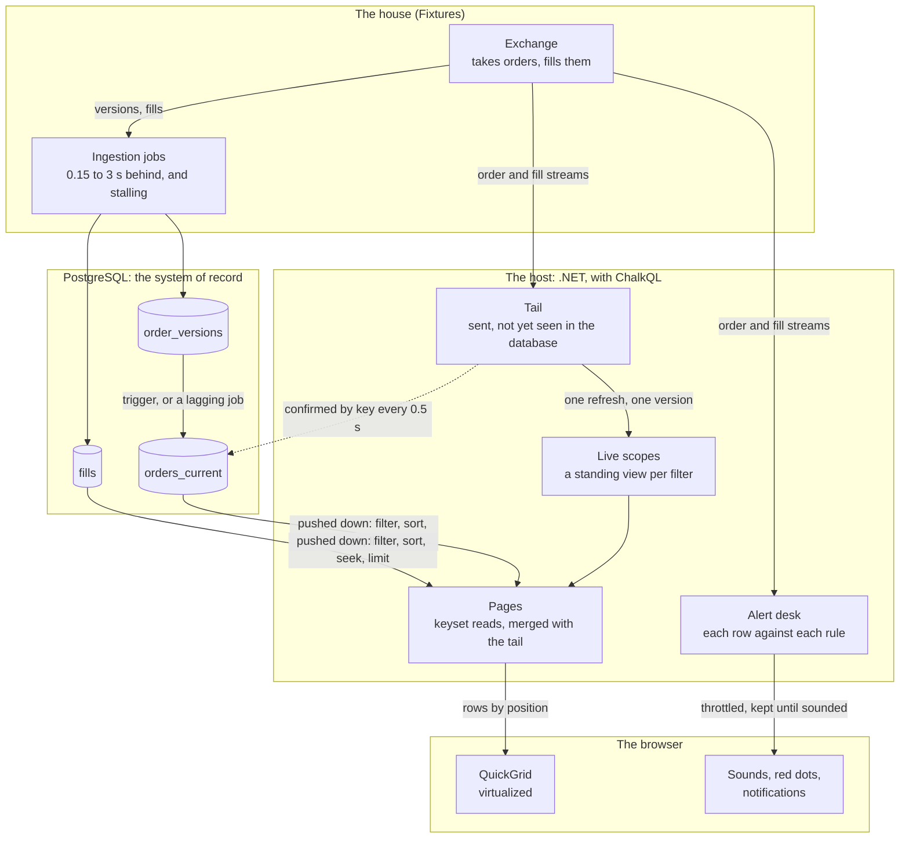
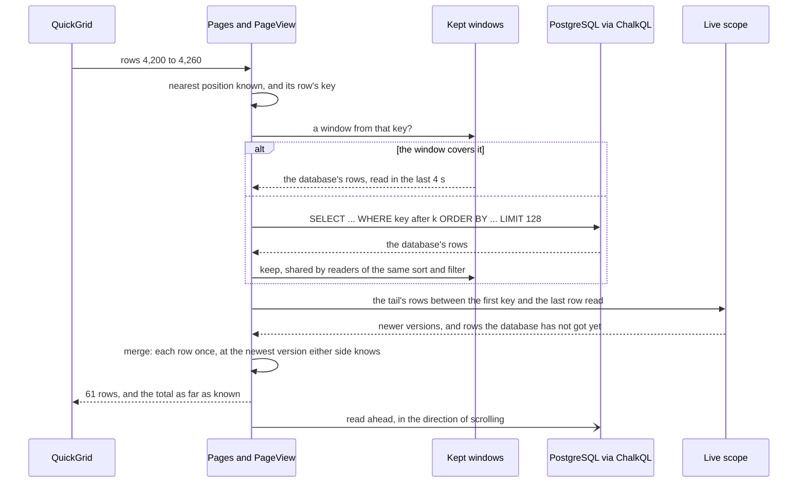

# Virtual blotter: an unobtrusive live grid

A trade blotter in Blazor Server and QuickGrid, over five million client orders and their fills in
PostgreSQL, while the house keeps taking orders and filling them. Every tab scrolls through all of its
rows, sorts by any columns, filters on any column, flashes what changes, and sounds alerts. The host
holds no copy of the corpus: it keeps what it holds inside a memory budget of a few megabytes, stops
any statement after 5 s, and never shows an order at an older version than one it knows of.

## A bolt-on, on purpose

Most live views are added to existing systems: someone else's database with an external feeds. 
So the blotter is built as a **bolt-on**, imposing the fewest assumptions. Of the
database it asks only what is reasonable: rows found by key, sorted and filtered, and an estimate
of a query's size. Of the streams, only that they deliver what is sent after a reader subscribes. ChalkQL
can then make the most it.

```bash
JAVA_HOME=/path/to/jdk-21 dotnet run -c Release --project dotnet/samples/Chalk.Sample.Blotter
```

Then open `http://localhost:5910`. The sample starts a PostgreSQL server of its own, in a temporary
directory, from PostgreSQL 16 or later installed on the machine (`brew install postgresql@16`), and
deletes it when it stops; one left by a sample that was killed is swept away by the next. ChalkQL's
planner runs on a JDK 21+, which `PlannerProcess` starts itself: set `JAVA_HOME`, or install Homebrew's
`openjdk@21`, which the sample looks for.

| Option | Default | |
|---|---|---|
| `--orders 500k` | `5m` | the corpus loaded at start: orders, their versions and their fills |
| `--current lagging` | `trigger` | how `orders_current` keeps up with `order_versions` (below) |
| `--disorder 0.02` | off | out of order from the start: that share of each stream's rows sent late, and half as many written to the database before they are sent (below); the page can turn it on and off |
| `--postgres "Host=…;Username=…;Database=…"` | | a server of your own instead: the sample makes a schema `blotter` there, refuses if one exists, and drops it when it stops |
| `--pg-bin /path/to/postgresql/bin` | found | the installation to start a server from |
| `--budget-mb 32` | found | the host's memory budget, fixed; without it, the host finds one (below); the page can change it while it runs |
| `--maintenance recompute` | `incremental` | how the live scopes keep current (below) |
| `--urls http://localhost:5911` | `http://localhost:5910` | |
| `--link-keys /path/to/folder` | `Chalk.Sample.Blotter/link-keys` under the user's local application data | where the keys that shroud shared links are kept (below) |

It does **not** assume:

- a watermark, a commit sequence or a log position on any row;
- a snapshot, or reads repeatable across statements;
- that the streams and the tables agree, or which runs ahead: a version may be in the database before
  the stream sends it, or sent long before the database writes it;
- that the table of current orders keeps up with the table of versions (`--current lagging` runs them
  apart on purpose);
- that the two streams agree with each other: a fill often arrives before its order;
- that a stream replays anything sent before the subscription;
- an index for every sort a reader picks, or a cheap count.

It does need to assume records are append-only:

- **Every change to an order is a new version**, numbered higher than the order's last, and a version
  once written never changes. The host keeps whichever side holds the higher version, and confirms the
  database by version alone, so a correction made in place, at the same version, would go unseen.
  Versions only need to rise within each order: nothing orders one order's versions against another's.
- **Fills never change**, and are only ever added.
- **Nothing is deleted.** The streams carry versions and fills, not removals, so the host has no way to
  learn that a row has gone. `order_versions` and `fills` only grow; `orders_current` changes in place,
  but only to a higher version.
- **Each stream sends everything after a reader subscribes**, mostly in the order it happened. A row
  may come late, after rows that happened later, or after the database has written it, and pages stay
  correct; but the count of what arrives above a held view is then right only once the late rows land,
  and the gap fill reaches back 30 s, so a row should not be later than that.
- **A key is never reused** for another order or fill.

What it takes on instead, in the host:

- **A tail**: what the streams have sent that the database has not been seen to hold, confirmed by
  key lookups every half second and let go five seconds after.
- **A merge**: every page is the database read live, with the tail laid over it, each order once, at
  the newest version either side knows.
- **A gap fill** at start and on resuming, for versions that were in flight when it subscribed.
- **Positions it learns**: a live table has none, so each grid ties the positions it has read to the
  rows found there, and reads from their keys.
- **Estimates rather than counts**, refined off the page's path, and the end of a tab learned from
  reads that reach it.

Each is described under [How it works](#how-it-works), with what it costs.

## What ChalkQL brings

ChalkQL is the engine under every read: one SQL dialect over the PostgreSQL tables and the host's own
in-memory tables, planned by Apache Calcite in a sidecar process and executed in the host's own. What
it does here that would otherwise be hand-written:

- **One statement across a database and live memory.** The tail is three keyed POCO tables
  (`live.tail`, `live.order_versions`, `live.tail_fills`) in the same engine as `blotter.*` in
  PostgreSQL. An order's page reads its history as one `UNION` of `blotter.order_versions` and
  `live.order_versions`, and the versions only the tail has with one `NOT IN` across the two.
- **Pushdown planned from what the host declares.** The sample tells ChalkQL each table's key, its
  indexes, its row count, and that its text is collated byte by byte. With that, the planner pushes the
  filter, the sort, the keyset seek and the limit into PostgreSQL's SQL, and keeps in the host only what
  PostgreSQL cannot do. "How this tab is answered", under the grid, shows the plan.
- **Standing views over the live data, kept current incrementally, inside a budget.** Each live scope
  (one per tab and filter in use) is a ChalkQL view over the tail: it takes the rows the filter can
  see, and on every change takes only the difference, rather than rerunning. Each has a state budget,
  and refuses rather than grow past it. `--maintenance recompute` trades a little more work an update
  for about a quarter of the memory.
- **Atomic refreshes.** The ingest loop changes the three tail tables as one engine version, so every
  view and every page sees a tail that is whole, never one table ahead of another.
- **Prepared statements, bound exactly.** Every page's SQL is prepared once and run with its key and
  filter as parameters, each given as its column's own .NET type; ChalkQL checks a parameter's type
  exactly against its column's, rather than converting a value that might then compare differently in
  the database and in the host.
- **A time limit per source** (`SourceOptions.QueryTimeout`), which cancels a statement that runs past
  it. The sample also gives its reading connections PostgreSQL's own `statement_timeout`, so the
  database stops the work too.

**Not exercised here: entitlements.** ChalkQL's policy layer decides which rows and which columns a
caller may see, applies that to every statement and every standing view as it is planned (pushed down
into the database's SQL, not filtered afterwards), and audits who read what. A real blotter would
scope rows to a desk or a client and hide columns such as markup from some readers. This sample
serves every reader everything, so none of it is shown.

## The domain

The reference data is the Tapline PivotTable sample's: twelve clients trading the house's linear
perpetuals (`BTC/USD Perp` and seven others) in US dollars, each in its region and through its
channels (FIX, API, GUI, Mobile, Voice), at the mark plus its channel's markup. A **client order** is
versioned: a fill or a cancel is a new version, numbered one higher, with its filled quantity, its
average price (the fills', weighted) and its status (New, Partial, Filled, Cancelled). A **fill** never
changes, and carries its order's details (client, region, channel, instrument, side), so a fill can be
filtered without its order. Orders and fills are identified by UUIDs (version 7), and nothing in the
host relies on their order: ids only break ties in a sort.

Order versions and fills come on **two streams**, each mostly in its own time order and neither
waiting for the other. The order stream runs up to 600 ms behind the fills, and a quarter of new
orders are filled at once, so a fill often arrives **before its order**, or before the version that
counts it. The streams are reliable from the moment a reader subscribes, and do not replay.

**Out of order** (`--disorder`, or the page's "Out of order" button): a share of each stream's rows is
sent late, after rows that happened later, by a delay that is log-normal about 400 ms, now and then
seconds, never more than 10; and half that share is written to the database first, at once, and sent
about 200 ms later, so the blotter finds those in the database before it hears of them. The ingestion
jobs already write rows out of order, each with a lag of its own, so the database may hold an order's
third version before its second; versions only ever rise within an order, and the trigger and the
lagging job keep the higher one. The vital statistics count the rows sent late and after the database.

## The database

Three tables in the `blotter` schema, `UNLOGGED`, their text collated `"C"`:

- `order_versions`: every version of every order, keyed by order and version.
- `orders_current`: one row per order, at its latest version, indexed newest first. This is what the
  blotter's order tab reads.
- `fills`: every fill, keyed by fill, indexed by order and newest first.

Ingestion jobs write each stream's rows some time after the stream sends them, 150 ms to 3 s, and
sometimes stall. `orders_current` keeps up one of two ways (`--current`):

- **trigger** (the default): a trigger on `order_versions` upserts the order's row in the same
  statement, the newer version winning.
- **lagging**: a job of its own applies what `order_versions` has been written, 0.5 s to 4 s later,
  and stalls now and then, so the two tables are often out of step.

The corpus is generated in C#, each order worked out from its number alone, and written with binary
`COPY` on several connections at once before any index or trigger exists; then the indexes are built
in parallel. Five million orders, about 12.5 million versions and 8.8 million fills load in seconds.

## What you see

**The grid**

- **Two tabs**, client orders and fills, each with its own sort, filters and position. QuickGrid's
  `Virtualize` asks for rows by position, and the host answers for any position in the millions.
- **Fills nested under their orders.** The chevron opens an order's fills beneath it, newest first,
  each marked ↳, as rows of the grid's one list (`Virtualize` wants every row one height); the order's
  own row does not move. They stay open while new fills arrive. A fill that came before its order is
  there once the order comes. Hovering a fill's order shows the order as both sides know it now, and
  says when the order has not arrived yet, or does not count this fill yet.
- **An order's page.** An order's id opens its page: every version and every fill, read from the
  database and the live tail in one statement each. A fill's id opens its order's page, that fill
  marked. The ↗ after the id shows while the pointer is on its row.
- **Time first, and frozen.** Each tab leads with its time: when the client placed the order, or when
  the order was filled. The expander, Time and Order (or Time and Fill) stay in place as the grid
  scrolls sideways. A time shows as `… 03:26:23`, an ellipsis where its date is; on hover, it shows in
  full, date and microseconds.
- **Columns hold their widths**, the widths they first took with rows in them, so headings do not
  shift as the grid scrolls; a value wider than its column is cut short with an ellipsis. "Columns"
  shows or hides any column but the frozen ones; Ver, Region, Channel and Filled start hidden. Fill %
  is worked out from the row in the host: shown, never sorted or filtered by, and refused if asked to
  be.
- **Numbers as finance writes them:** no zero before the point of a fraction and none after its last
  digit that counts (.25, not 0.2500), a dash for nought, prices to six significant figures and in
  scientific notation past eight digits. Every value is in the system's monospace, zeros slashed.
- **Flashes.** The cells of a row that changed flash for 2.4 s, and an order or fill just sent flashes
  whole for 3 s. A row scrolled into view does not flash. Rows cut by the grid's edges fade.

**Sorting and filtering**

- **Any columns.** A click sorts by a column, descending; again, ascending; again, back to the tab's
  own order, newest first, which Time shows with a muted arrow. A shift-click does the same within a
  sort by several columns, and the header shows each column's place in it. QuickGrid sorts by one
  column itself; its multi-column sort is a pull request
  ([dotnet/aspnetcore#62604](https://github.com/dotnet/aspnetcore/pull/62604)) not yet merged, so the
  page draws its own headers.
- **A filter on every column.** The funnel before each heading opens the column's filter. Active
  filters show as pills above the grid.
  - Ids (order, fill): typed or pasted, matched exactly.
  - Text (client, ClOrdId, instrument): picked or typed, matched exactly or by what they **start
    with**. The chooser offers the column's most frequent values over the period of interest (the
    tab's time filter, or the last day), read from the database and narrowed as you type.
  - Region, channel, side, status: ticked. Numbers: at least, at most. Times: from, to (UTC).
- **The cost, on request.** "How this tab is answered" shows the page's SQL, ChalkQL's plan, and
  PostgreSQL's own plan of the same page: newest first, a read of a hundred rows down an index; sorted
  by a column no index has, the whole table.
- **A time limit.** Every statement is stopped after 5 s. A page that hits it says so, and keeps the
  rows it had, faded under the reason, rather than emptying the grid.

**Live**

- **New rows push down at the top.** Scrolled away, the rows in view stay where they are, and an
  "N new above" pill counts what has arrived. Scrolling up near the top lets them in, 30 at a time,
  above the rows in view, which stay put; reaching the top, however fast, goes back to the live top.
- **Above the grid**, whether the host is serving and what it holds against its budget. **Vital
  statistics**, under it and closed at first: the feed, how `orders_current` is kept, PostgreSQL's size
  and lag, the tail, the statements run and stopped, and the confirmations. Closed, none of it is read.
- **Simulate burst** makes 3,000 changes at once; **Stall database 20 s** stops the database writing
  while the streams go on; in lagging mode, **Stall orders_current 20 s** stops only its job. Both show
  while the pointer is on the page. Try them with a small budget chosen on the page to see the host
  refuse.

**Copy and share**

- **Copy** (⧉) puts the rows in view on the clipboard, as tab-separated text, which a sheet takes as
  cells, and as a table. Times keep their date and ids are whole.
- **Share** copies a link that opens the same view in a new window: the tab, the sort, the filters,
  the hidden columns, and, scrolled away from the live top, the first row in view by its keyset (its
  value of each column sorted by, then its key). Opened, the row's place is counted, and the grid is
  scrolled there and held. Nothing is kept for a link, and a link not understood is refused whole,
  saying what. For example:
  `/?tab=fills&sort=-client,qty&hide=&f.side=Buy&f.qty.min=0.1&f.instrument.starts=B&at.client=FERN&at.qty=0.5&at.fill_id=…`.
- **Private or readable.** A private link shows none of the view's data: the filters' values and the
  row held at go in one opaque `s=`, encrypted and signed with ASP.NET Data Protection; the tab, the
  sort and the hidden columns stay readable (`/?sort=-client&s=CfDJ8…`). The keys are kept in a folder
  (`--link-keys`, not encrypted at rest), so links open after a restart; they rotate every 90 days, and
  old ones are kept to open what they shrouded. A link may give any part as is or shrouded, but not
  both ways; a shrouded part altered, or from another blotter's keys, is refused.

**Alerts**

- **A saved filter with a sound.** The bell on the tab bar opens the alerts: each is a tab's filters,
  saved in the browser, with one of 22 short recorded sounds and a throttle. A new one takes the tab's
  filters as they are; each can be heard, muted or removed.
- **Evaluated by the host, from the streams.** Every order version and fill the streams send is
  weighed against each rule as the host reads it, however far behind a grid has fallen and whether or
  not a page is open. A fill fires a rule when it passes the filter; an order, when a version of it
  comes to pass the filter, and not again until it has left it. Within its throttle, a rule gathers
  its rows and sounds once, saying how many (×26).
- **None missed.** A browser's alerts wait until a page of it has sounded them. A page opened again
  within 10 minutes says what fired meanwhile.
- **Sound** is a recording in `wwwroot/sounds`, mono and 8-bit (about 280 KB for all 22), served at a
  versioned address the browser keeps for good, fetched the first time it plays and mixed through Web
  Audio. A browser lets a page make sound only once someone has clicked on it, so with alerts set to
  sound the page opens with a splash that asks.
- **Unseen alerts** show as a red dot, not a count: on the bell until the alerts are opened, and, in
  the background, on the page's icon until the page is looked at. With "Notify in the background"
  ticked and the browser's leave, the system shows a notification. Scrolled away from the live top,
  the "N new above" pill shows a bell once an alert has fired on the tab.

Escape closes whatever is open over the page.

## The code

| Folder | |
|---|---|
| `Grid` | what any live grid over a versioned table needs, whatever its rows: rows (`IRow`, `KeyRow`), columns and their formats, tabs, sorts, filters, view links and their shrouding, alert rules |
| `Domain` | the trades: client orders and their fills (`Trades`), the two tabs over them, the reference data, and `TradeStore`, the trade model in PostgreSQL |
| `Fixtures` | what stands in for a real house: the generated corpus and its `Seeder`, the simulated `Exchange` and its streams (`Feed`), the lagging ingestion jobs, and a PostgreSQL server of the sample's own |
| `Live` | the bolt-on: the tail, the merge, the live scopes, pages and positions, counts, alerts, and the host that runs them |
| `Components` | the Blazor pages and the grid |

`Grid` knows nothing of trades, and `Domain` nothing of how it is shown live; `Live` and the grid
component still speak of orders and fills.

## How it works

Who does what, lane by lane: the house writes to PostgreSQL late, and streams to the host at once; the
host reads PostgreSQL live, lays its tail over each page, and weighs every row the streams send
against the alerts.



Each tab is two halves, merged.

1. **The database, read live.** For orders, `orders_current`; for fills, `fills`. Read through ChalkQL
   with the filter, the sort and the limit pushed down into PostgreSQL's own SQL.
2. **The live tail**: every order version and fill the streams have sent since the host subscribed,
   that the database has not been seen to hold yet. The orders are a keyed POCO table in ChalkQL, each
   row carrying the order's latest version and, column for column, `orders_current`'s row for it when
   last looked up. The versions behind an order, and the fills, are tables of their own.

**Confirmation.** Every half second the host looks the tail's rows up in the database by key. An order
the database holds at the tail's version or later, and a fill it holds, is confirmed, and leaves the
tail five seconds later. That is a second longer than a window of the database's rows is kept (below),
so no page merges a database read from before a version landed with a tail that has already let it go.
A version the database holds already when the stream sends it never enters the tail.

A page, as the grid asks for it:



**Reading a page.** A page is read from a key: the database's first rows at or after it in the tab's
order, then every tail row between that key and the last row read. The read decides nothing past its
last row, so a tail row beyond it waits for the next read. An order read at a version older than the
tail's gives way to the tail's version, placed where that version sorts, or not at all if it no
longer passes the filter. A tail row placed in the stretch whose database row was not read is looked
up: if the database has moved past the tail meanwhile, the database's row stands, wherever it sorts.
So each order appears once, at the newest version either side knows. The read is written so that
PostgreSQL can start an index at the key: the condition is spelled column by column, with the leading
column's bound repeated alone in front. Every limit is a literal, rounded up to a power of two, so
PostgreSQL plans for the rows a page needs, and the prepared statements stay few.

**Positions.** `Virtualize` asks by position, and a live database has no fixed positions. Each grid
keeps positions it has read, each tied to the row found there (`PageView`). A page near one is read
from that row's key, forwards, or backwards in the reversed order for rows above it. At the top,
positions are counted from the first row on every state, so new rows push the rest down. Scrolled
away, they hold. A jump far from every position known (dragging the scroll bar) is placed by the
database's own `OFFSET`, which knows nothing of the tail, so positions deep in a tab are approximate.
Each page is still read whole from one key, so a page never repeats or skips a row.

**Windows and read-ahead.** What the database returns is kept for four seconds as a window: a run of
its rows in one order from one key, shared by every reader of the same tab, filter and sort. A read a
window covers is answered from it, with the tail laid over it afresh. A sort whose reads take longer
than 25 ms (no index serves it, and the database sorts the whole table) is read in windows of 2,048
rows, which cost the database about what a page does. After each page, the next window in the
direction of scrolling is read in the background. The grid also renders 60 rows beyond the view
either side. At 5 million orders, scrolling a ClOrdId sort 30 rows at a time, two steps in thirty
showed placeholder rows, briefly, and the database was read about once in ten.

**Starting, and the gap fill.** The host subscribes to the streams, and then sends the database one
last request: every version `order_versions` holds from the last 30 s. It takes each as if the stream
had sent it, and lets go at once of those `orders_current` already shows. A version that was in flight
when the host subscribed is then shown even if `orders_current` does not have it yet. Fills need no
gap fill: the blotter reads them from the table they are written to.

**Live scopes.** For each tab and distinct filter on the open pages, a ChalkQL standing view over the
tail (`LiveScope`) holds what the filter can see. For orders, that is every order that passes the
filter now, or whose database row did: its two sets of columns let the filter be tested against both
in one statement. For fills, it is every fill in the tail that passes. Pages that filter alike share
one scope, whatever they sort by and wherever they are scrolled. A page sorts its scope in the host,
which is cheap because a scope is a slice of the tail, never of the corpus.

**Sizes, without counting.** No page waits for a count. A grid is sized at once by PostgreSQL's
estimate (`EXPLAIN`, a few milliseconds). Once a reader scrolls away from the live top, the rows are
counted off the page's path, on a connection of their own, for up to 60 s, and again every 30 s while
pages use the filter; a count past 60 s is given up, and the estimate stays. Reads learn the rest: one
that comes back short has found the last row, and the grid ends there; one that finds more past the
end goes on a screenful further. PostgreSQL once estimated a filter at 1,989 rows that passes 32,170;
the count put the scroll bar right, and the end was where the reads found it.

**What arrives above a held view** is counted from the streams, not the database. The host hands every
batch it reads off the streams to the counter, whether or not the tail takes it. Each row is weighed
against what it was: what the counter last saw of it, the tail's rows when the view was held, or, for
an order it had not seen, its version as of then, looked up by key in `order_versions`; an order placed
since, or a fill, is new. A shared link's row is still placed by a count, once, with PostgreSQL's
estimate if that count is too slow.

**The budget** covers what the host holds: the tail, in ChalkQL and in the host; the scopes' views and
their states; and the windows and fills it keeps for a moment, which may hold a quarter of the budget
at most and give way first. Unless `--budget-mb` sets one, the host starts at 8 MB, and whatever would
be refused for want of budget raises it to the next of 16, 32 and 64 MB instead; it never lowers it.
Past 64 MB, or once a budget is chosen on the page, a refusal is a refusal. If the scopes no page is
using giving way is not enough, because the database is too far behind, the host stops serving and
says why. It never drops a version to stay in budget. While it refuses, it keeps reading the streams,
keeps what the database has not been seen to hold, and serves again once `orders_current`'s newest
order is within 5 s of the stream's, from what it kept and a new gap fill.

## What correct means here

Each order is shown at the highest version known when the page is read: known to the database (in
`orders_current`, or in `order_versions` through the gap fill) or sent on the stream since the host
subscribed. No order is missing or shown twice, and the rows are in order.

`Oracle` works out what a page should be in PostgreSQL alone. The truth is `orders_current` with every
newer version laid over it: those `order_versions` holds, and those the stream has sent, which the
oracle copies into a temporary table. For fills, it is the fills the database holds and those the
stream has sent. Then it filters, sorts and limits in one statement, with the filter's values written
in.

That is exact only while nothing moves, so `tests/Chalk.Sample.Blotter.Tests/BlotterHostTests.cs`
checks two ways, with random pages from `Probe`:

- **While the market runs**, through bursts and stalls, every page must hold its invariants: rows in
  order, none twice, each passing the filter.
- **Held still**, in rounds: the market paused, a burst the stalled database cannot write, the host
  caught up with the streams. Every page must then be the oracle's, row for row: once with the tail
  covering the database, and again once the database has written everything.

The pages use random filters on one or two columns of every kind, random sorts of one to three
columns, and random positions. On 2026-10-23, at 200,000 orders, in both `--current` modes, every page
under load held its invariants and every page held still matched the oracle. The tests also cover
fills that arrive before their orders, the gap fill, the time limit, the budget's refusals and serving
again, rows held in place while rows arrive above them, the count of what arrives above a held view
against the merged page (exact, for sorts on columns that never change and on ones that do), estimates
and counts off the page's path, and an order's history read from both sides.

A longer run of the same checks, against a busy market, is a test run by hand, which prints PostgreSQL's
estimates and what the host held:

```bash
BLOTTER_PROBE_SECONDS=300 BLOTTER_PROBE_ORDERS=5000000 dotnet test dotnet/tests/Chalk.Sample.Blotter.Tests --filter Random_pages_hold
```

`SortSpecTests`, `FilterSpecTests`, `ColumnsTests`, `ViewLinkTests`, `AlertSessionTests`, `FlashesTests`
and `NestingTests` cover the host's own rules: sorting, filtering, number formats, links and their
shrouding, alerts and their throttles.

## Aspirational mechanical sympathy

With carte blanche ownership a blotter would be built with more sympathy for the data flow, greatly
reducing the cost of data source queries:

- **A commit sequence on every row, and the stream's watermark in step with it.** The tail could let a
  row go the moment the database's watermark passes it: no confirmation lookups, no grace period, no
  windows whose life is tied to that grace.
- **The stream taken from the database's own log** (logical replication, change data capture). Stream
  and table would agree by construction: no order behind its fills, no database ahead of the stream,
  no gap fill.
- **Reads at a snapshot that matches the watermark.** Every merge would be exact, rather than "the
  newest version either side knows".
- **A stream that replays from an offset.** Starting, and serving again after a refusal, would need
  no 30 s gap fill and no kept tail.
- **Indexes, or a column store, for the sorts readers use, and counts kept as rows change.** No sort
  of the whole table, no count that reads it, and the 5 s limit would seldom bite.
- **The current table kept in the same transaction as the versions** (the sample's default trigger),
  never by a job that runs behind.
- **A dense sequence in the default order.** A jump to a far position would be exact, not placed by
  `OFFSET`.

The sample dispenses with all of these so that it works with minimal support, and each item above
marks a place where the host approximates or does extra work because of it.

## Not here, yet

- Entitlements (above).
- Free-text search.
- A refusal by query cost estimate.
- Use of Tapline could greatly improve scalability. On Blazor Server the grid renders on the server, and ChalkQL's views already give each
  reader what changed. Tapline would carry the same answers to a WebAssembly grid, headless clients or
  many nodes. `LiveScope`, `ScopeState` and `Pages` are the seam.
- Memory figures are the host's own estimates of what it holds, and the views' own count of their
  state. The vital statistics show the process's managed heap beside them for comparison.
